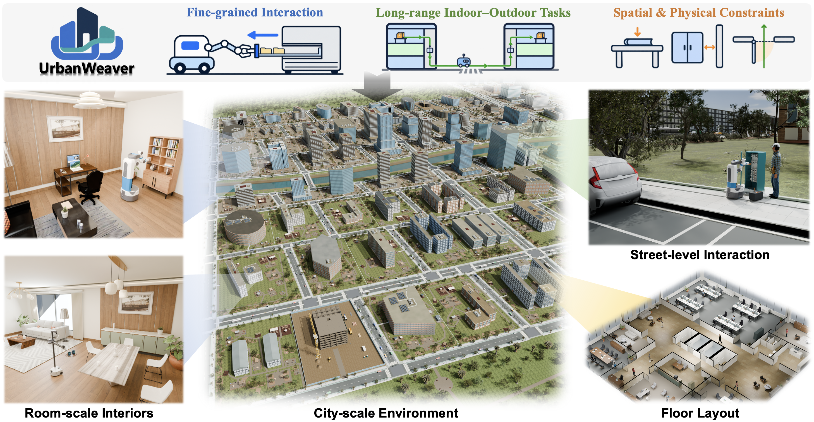

# UrbanWeaver

[English](README.md) | **简体中文**

**From Streets to Rooms: Building Fine-Grained Urban Simulation Environments**

UrbanWeaver 从一段文字需求出发，构建包含相连街道、建筑、楼层、房间和家具的城市。不同尺度的智能体交换空间约束，根据编译后的几何检查布局，并对指定范围进行修复。生成的城市可以导出为 OpenUSD，在随附的 Web Viewer 中查看，也可以继续用自然语言编辑。Python 包和命令行入口均使用 `cityg`。



## 机器人跨楼配送演示

Fetch 机器人从 A 栋 403 房间取走杯子，乘电梯下楼，沿人行道通过斑马线，再进入 B 栋乘电梯到七楼，把杯子放在 716 房间的桌上。这段 72 秒的脚本演示展示了走廊、楼门和街道如何连成一条完整路线。

https://github.com/user-attachments/assets/828aa053-e425-4e9c-9de8-03fb6ca75c56

[图像和视频的资产来源](docs/media/credits.md)

## 离线生成第一个城市

在仓库根目录下，使用 Python 3.10 或 3.11 运行：

```bash
python -m pip install -e .
python -m cityg generate --spec examples/research_specs/01_residential_neighborhood.json \
  --output outputs/first_city --backend openusd
python -m cityg validate outputs/first_city/city.json
python -m cityg view outputs/first_city
```

这个示例使用确定性规划和程序化几何，在 CPU 上即可运行。仓库已包含编译好的 Viewer。

## 从自然语言生成城市

启动兼容 OpenAI 接口的多模态模型服务，在本地配置副本中填写模型名和服务地址，并安装用于视觉复查的 Chromium：

```bash
cp configs/full_pipeline.env configs/pipeline.local.env
python -m pip install playwright pillow 'shapely>=2.1,<3'
python -m playwright install chromium
CITYG_CONFIG=configs/pipeline.local.env bash scripts/run_cityg_pipeline.sh \
  "构建一个含十栋建筑的混合社区，包含相连的街道和一座小公园。在三栋建筑中共精细布置十个房间。" \
  outputs/mixed_district
```

配置项为 `LLM_BASE_URL`、`VLM_BASE_URL`、`LLM_MODEL` 和 `VLM_MODEL`。默认配置连接本机 8000 端口上名为 `cityg-llm` 的服务。请选择空的输出目录。脚本会打印生成结果、复查报告和便携 Viewer 的路径。

## 资产与可选服务

仓库包含程序化几何、资产元数据和准备脚本。复现带纹理的场景时，请从各上游来源获取相应的网格、纹理和模型权重。注册表记录了程序化资产与可下载资产。详见[资产来源目录](assets/external_sources.json)和[第三方声明](THIRD_PARTY_NOTICES.md)。

材质集成测试使用的可选 PBR 地面纹理可通过 `python scripts/download_polyhaven_ground_materials.py` 下载。

如需生成缺失资产，可设置 `ASSET_GENERATION_ENABLED=true` 并用 `ASSET_URL` 指向已有的 Hunyuan worker。如需在本机自动启动 worker，请先准备模型环境和 CUDA 扩展，设置 `ASSET_WORKER_AUTO_START=true`，并导出 `CITYG_ASSET_PYTHON`、`CITYG_HUNYUAN_REPO`、`CITYG_HUNYUAN_MODEL_ROOT` 和 `CITYG_HUNYUAN_T2I_MODEL`。通过流程配置中的 `ASSET_WORKER_GPU` 选择显卡。

## 使用生成结果

- 编辑指令和受保护的场景状态见[场景编辑指南](docs/editing.zh-CN.md)。
- 可复现截图和视觉复查见[无头渲染指南](docs/headless_rendering.zh-CN.md)。
- CPU 物理验证使用独立的 [ovphysx 环境](environments/ovphysx.yml)。
- 项目代码采用 [Apache 2.0](LICENSE) 许可。第三方组件与资产遵循各自的上游条款。
